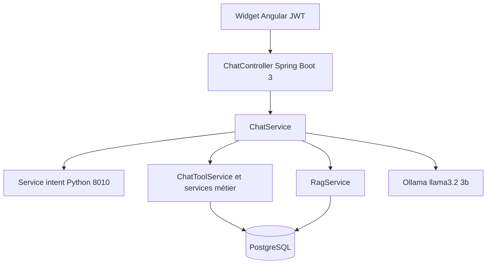
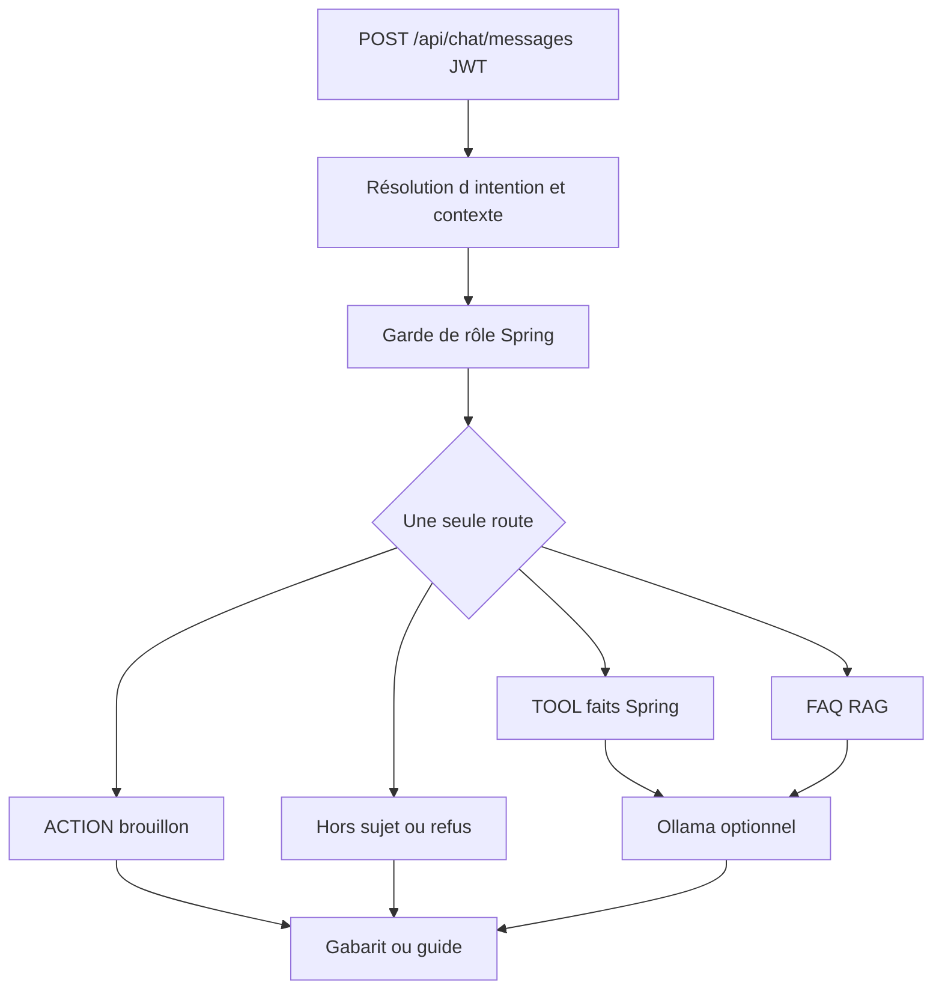
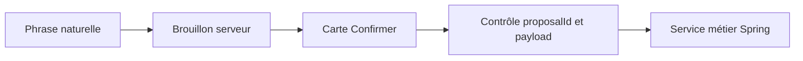

# Assistant conversationnel RH Paie

**Document de présentation** — projet de fin d’études  
**Périmètre :** l’assistant RH intégré à l’application RH Paie  
**Nature :** documentation de l’existant (aucune nouvelle fonctionnalité)

---

## 1. Résumé exécutif

RH Paie est une application web de gestion des ressources humaines et de la paie. L’apport documenté ici est un **assistant francophone, conscient des rôles**, intégré dans l’interface réelle (widget Angular), branché sur les **mêmes services Spring et la même base PostgreSQL** que le reste du produit.

L’assistant n’est pas un modèle de langage libre connecté à une base fictive. Il **classifie l’intention**, **lit des faits métier** via les services existants, **retrouve des procédures** dans un guide interne, et **prépare des écritures** seulement lorsqu’un brouillon côté serveur est confirmé.

| Principe | Mise en œuvre |
|---|---|
| Comprendre la question | Encodeur CamemBERT préentraîné + régression logistique entraînée sur le corpus RH du projet |
| Dates de congé | Règles déterministes en Java — Ollama ne choisit pas les dates |
| Vérité métier | Services Spring + PostgreSQL |
| Procédures | RAG en mémoire sur le guide (et documents admin) |
| Formulation | Ollama `llama3.2:3b` local, pour TOOL et FAQ uniquement |
| Écritures | Brouillon serveur + bouton Confirmer + contrôle du `proposalId` |

**CamemBERT et Llama n’ont pas été entraînés « from scratch ».** Le travail ML du projet porte sur le corpus d’intentions, le classifieur, l’évaluation, le RAG, l’orchestration et les garde-fous.

**Validation finale sur le widget réel (stack complète, base démo ressemée) : 22 scénarios, 22 réussis, 0 échec, aucune erreur API.**

---

## 2. Contexte et problématique

Un logiciel RH/paie expose déjà des écrans, des règles et des droits. Un assistant n’a de valeur que s’il **respecte ces mêmes règles** : un employé ne doit pas voir la file d’attente d’entreprise ; un chiffre de solde ne doit pas être inventé ; une validation de congé ne doit pas s’exécuter sur une phrase mal comprise.

La problématique traitée est donc :

> Comment offrir une conversation naturelle en français, tout en gardant **l’application existante** comme source de vérité et comme unique autorité d’écriture ?

Les risques évités :

- laisser un LLM interroger PostgreSQL ou décider un solde ;
- exécuter une écriture dès la première phrase ;
- mélanger un guide FAQ avec des faits d’un tour TOOL précédent ;
- faire dépendre l’autorisation du seul classifieur.

---

## 3. Objectifs de l’assistant RH

| Objectif | Pour l’utilisateur | Pour le produit |
|---|---|---|
| Lecture rôle-aware | L’employé consulte *ses* données ; l’admin consulte *l’opérationnel* | Réutilisation des services existants |
| Procédures | Réponses guidées (congés, paie) | Guide interne + abstention si trop faible |
| Actions sûres | Créer / annuler un congé ; revue admin | Confirmation obligatoire |
| Traçabilité | Pastille de source (Données, Guide, Action, Accès refusé, Hors sujet) | Confiance et pédagogie |

Hors périmètre actuel de l’assistant : pointer depuis le chat, lancer un calcul de paie, multi-intention, Derja, Redis.

---

## 4. Architecture globale

| Couche | Technologie | Rôle |
|---|---|---|
| Interface | Angular, widget flottant | Saisie, pastilles de source, Confirmer / Annuler |
| API | Spring Boot 3, Java 21, JWT | Orchestration, garde de rôle, brouillons |
| Données | PostgreSQL, Flyway | Vérité métier + brouillons d’action + messages |
| Intentions / embeddings | Python, port **8010** | `POST /predict`, `POST /embed` |
| Encodeur | `Lajavaness/sentence-camembert-base` (copie locale) | Vecteurs de phrases — **non réentraîné** |
| Classifieur | Régression logistique | 19 classes, corpus projet |
| Formulation | Ollama `llama3.2:3b` | Reformulation TOOL/FAQ uniquement |

L’encodeur et le classifieur d’intentions vivent dans `ml/intent/`. Ollama n’a **aucun** accès JDBC.

---

## 5. Description des composants

| Composant | Fichier / zone | Responsabilité |
|---|---|---|
| Widget | `frontend/.../chat-widget/` | UI, chips, confirmation liée au `proposalId` |
| `ChatController` | backend chat | `GET /greeting`, `POST /messages`, confirmations, discard |
| `ChatService` | backend chat | Pipeline, rôle, Ollama, brouillons, contexte lecture |
| `IntentClassifierClient` | backend chat | Appel :8010 + seuil 0,55 + repli mots-clés |
| `KeywordIntentFallback` | backend chat | Repli déterministe si modèle faible ou service down |
| `ReadFollowUpResolver` | backend chat | Suites de lecture incomplètes |
| `InMemoryConversationContextStore` | backend chat | Contexte lecture, TTL 30 min, clé `userId` |
| `JavaLeaveDateExtractor` | backend chat | Dates / durées / corrections limitées |
| `LeaveDraftSlotFiller` | backend chat | Remplissage du brouillon de création |
| `AdminLeaveReviewService` | backend chat | Liste numérotée, parsing d’ordres, payload de revue |
| `ChatToolService` | backend chat | Lecture via services métier existants |
| `RagService` | backend chat | Index en mémoire, cosine, abstention |
| `ChatFaqDocumentService` | backend FAQ | Upload md/txt/pdf (PDFBox), max 5 Mo |
| `OllamaClient` | backend chat | `POST /api/generate`, timeout lecture 25 s |
| `ChatGreetingService` | backend chat | Accueil lecture seule, sans Ollama |
| NLP Python | `ml/intent/` | CamemBERT + logistic regression + `/embed` |

---

## 6. Pipeline conversationnel

Ordre réel dans `ChatService.resolveIntent` (simplifié) :

1. Bascules explicites d’action (création / annulation employé, décision de revue admin).
2. Lecture personnelle employé (`mes demandes`, solde, etc.).
3. Question explicite de **file entreprise** → `PENDING_LEAVES` (le garde refuse l’employé).
4. Si un brouillon de **revue admin** est ouvert : les suites de revue restent dans le clarificateur (y compris une question courte hors sujet).
5. Classification CamemBERT / mots-clés.
6. Une FAQ ou une intention complète autonome **l’emporte** sur un ancien domaine de lecture.
7. Le contexte de lecture ne s’applique qu’à une **suite incomplète**.

Une requête produit **une seule** route : TOOL, FAQ, ACTION, refus, ou hors sujet. Pas de multi-intention.

**Formulation :**

- ACTION, hors sujet, file `PENDING_LEAVES` (liste admin déjà gabaritée), refus de rôle, FAQ sans retrieval : **Ollama n’est pas appelé**.
- FAQ : historique factuel vide (les faits TOOL précédents ne sont pas renvoyés à Ollama).
- TOOL (hors file admin) : Ollama peut reformuler ; si la reformulation est infidèle, le gabarit est conservé.

---

## 7. Gestion des rôles et sécurité

Rôles utilisés par l’assistant : **EMPLOYE** et **ADMIN_RH**.

| Intention | EMPLOYE | ADMIN_RH |
|---|---|---|
| Solde, mes demandes, bulletins, mes contrats, salaires, documents de sortie, créer / annuler | autorisé | non (garde) |
| File d’attente, contrats à échéance, statut paie, sorties, revue batch | refusé | autorisé |
| FAQ, calendrier, hors sujet | selon le cas | selon le cas |

Exemple volontairement « ambigu » :

> Employé : « Combien de congés en attente ? »

Cette formulation désigne la **file entreprise**. Le système la classe `PENDING_LEAVES`. Le **garde Spring** refuse : aucun listing d’entreprise n’est renvoyé. Une formulation personnelle (`Mes demandes`, `seulement celles en attente`) reste sur `MY_LEAVE_REQUESTS`.

Le classifieur peut se tromper. **L’autorisation ne dépend pas de cette perfection** : `ChatIntent.allowedFor(role)` est appliqué après la classification. Un employé qui obtiendrait une étiquette admin verrait un refus, pas les données.

JWT : chaque appel chat est authentifié. Le brouillon d’action est **lié à l’utilisateur** (contrainte unique `user_id`).

---

## 8. Classification d’intentions

### 8.1 Ce qui est préentraîné / ce qui est au projet

| Élément | Origine |
|---|---|
| Encodeur de phrases CamemBERT | Préentraîné `Lajavaness/sentence-camembert-base` |
| Régression logistique | Entraînée sur le corpus RH du projet (`class_weight=balanced`) |
| 1 280 énoncés, 19 classes | Corpus projet (exemples français rédigés + exemples Avature mappés) |

Le service Python expose `/predict` et `/embed`. Spring n’entraîne pas le modèle à l’exécution.

Les 19 classes du corpus correspondent aux intentions métier/FAQ/hors sujet (sans `UNKNOWN`). `UNKNOWN` est un **repli de confiance** côté Spring.

### 8.2 Évaluation holdout (fichier `ml/intent/metrics.txt`)

| Métrique | Valeur |
|---|---|
| Découpage | 1 024 train / **256** holdout (stratifié, `random_state=42`) |
| Accuracy | **0,7656** (76,56 %) |
| Macro précision | 0,7078 |
| Macro rappel | 0,7686 |
| Macro F1 | **0,7237** |

Frontières plus faibles observées sur le holdout (exemples) : `PENDING_LEAVES`, `MY_LEAVE_REQUESTS`, `CANCEL_LEAVE_REQUEST`, `FAQ_LEAVE` vs `CREATE_LEAVE_REQUEST`, `FAQ_LEAVE` vs `CANCEL_LEAVE_REQUEST`.

Ces confusions **ne donnent pas un droit d’accès**. Elles peuvent seulement mal router vers un gabarit, un refus, ou une FAQ.

### 8.3 Seuil et repli (`chat.min-confidence` = 0,55)

Dans `IntentClassifierClient.choose` :

| Situation | Décision |
|---|---|
| Modèle ≠ UNKNOWN et confiance ≥ 0,55 | Intention modèle |
| Sinon, mots-clés ≠ UNKNOWN et confiance ≥ 0,55 | Repli mots-clés |
| Les deux faibles | `UNKNOWN` → comportement non-outil sûr (hors sujet / pas d’outil métier) |
| Service :8010 indisponible | Mots-clés seuls |

`predictForRole` peut substituer un repli **autorisé** si le modèle a renvoyé un TOOL/ACTION interdit pour le rôle. Le garde Spring reste ensuite appliqué dans `resolve()`.

---

## 9. Compréhension des dates

Les dates de congé sont extraites par **`JavaLeaveDateExtractor`** (règles Java). Ollama **ne parse pas** les dates et n’écrit pas dans le brouillon.

Horloge de référence des évaluations : **2026-09-16**.

| Campagne | Résultat | Statut |
|---|---|---|
| Régression unitaire verrouillée | **46/46** | Assertée dans `LeaveDateRobustnessEvalTest` |
| DEV (100 cas) | **97/100** | Campagne d’évaluation du parseur |
| HOLDOUT (50 cas) | **48/50** | Non utilisé pour retuner le parseur |
| Faux-confiants DEV+HOLDOUT | **1/150** | Une date affirmée à tort |

Formes supportées (exemples) : `demain`, dates explicites, plages, `vendredi de cette semaine`, `10-05-2027` lu comme **10 mai 2027**, `du 2 mars 2027 au 3 mars 2027` (les deux bornes sont conservées).

**Ambigu, clarification obligatoire :** `cette semaine`, `la semaine prochaine` (pas d’invention lundi–vendredi).

**Corrections / négations limitées** (atomes du type demain / jour de semaine) :

- `je veux demain, non plutôt vendredi` → vendredi  
- `pas lundi mais mardi` → mardi  
- aussi : `plutôt Y`, `finalement Y`, `je voulais dire Y`, `pas X, Y`

Ce n’est **pas** une compréhension temporelle générale du français. Les formes hors grammaire (négations riches, références vagues « bientôt ») restent ambiguës ou non supportées.

---

## 10. Accès aux données métier

**Principe :** « Spring et PostgreSQL fournissent les faits ; le LLM ne change que la présentation. »

`ChatToolService` appelle les services déjà utilisés par les écrans (solde, demandes, contrats, bulletins, paie, sorties, etc.).

Lectures **employé** (vérifiées dans le code) :

- solde de congé ;
- ses demandes (filtres de statut possibles) ;
- contrats (filtre « le plus proche de l’échéance ») ;
- bulletins, salaires, documents de sortie ;
- calendrier des absences.

Lectures **admin** :

- file d’attente (via `AdminLeaveReviewService.listPendingAndSnapshot`, liste numérotée) ;
- contrats à échéance ;
- statut de paie du mois (consultation, **pas** lancement du calcul) ;
- synthèse des sorties.

**Pointage :** les intentions `MY_ATTENDANCE` et `FAQ_ATTENDANCE` existent, mais `ChatService` **redirige vers le menu** (« utilisez l’écran de pointage »). Pas de badgeage dans le chat.

---

## 11. RAG et base documentaire

### 11.1 Sources et index

Guides empaquetés (`backend/src/main/resources/chat/faq/`) :

- `conges.md`
- `paie.md`
- `pointage.md`

Compléments admin : **md, txt, pdf** (≤ 5 Mo). Un PDF est lu avec **Apache PDFBox** (`PDFTextStripper`).

Découpage : sections `##` en priorité ; sinon blocs d’environ 800 caractères. Représentation indexée : **titre + corps**. Stockage : **liste en mémoire** (pas de base vectorielle). Rechargement au démarrage et après upload/suppression.

### 11.2 Similarité et abstention

| Règle | Valeur dans `RagService` |
|---|---|
| Similarité | Cosinus des embeddings CamemBERT |
| Top-K | 3 |
| Bonus de rang si même domaine FAQ | **+0,06** (classement seulement) |
| Seuil de preuve brute | cosine **> 0,32** |
| Zone faible | brute ≤ 0,34 : exige une marge top1−top2 **≥ 0,08** |

Le bonus d’intention **n’autorise pas** un voisin sémantiquement trop faible : l’abstention s’appuie sur le cosine **brut**. Retrieval vide → message d’abstention, **Ollama non appelé**.

### 11.3 Évaluation FAQ (`ml/rag/`)

Jeu : **34** questions (**26** positives, **8** négatives).

| | Recall@1 | Recall@3 | Faux positifs (négatifs qui passent) |
|---|---|---|---|
| Avant abstention plus stricte | 16/26 = 61,5 % | 23/26 = 88,5 % | 6/8 |
| Après (règle actuelle) | **15/26 = 57,7 %** | **22/26 = 84,6 %** | **1/8** sur la ligne *frozen* de `rag_metrics.txt` |

Le Recall a **légèrement baissé**. L’objectif n’était pas de le maximiser : moins de réponses FAQ non étayées, au prix de quelques voisins valides mais trop faibles. **Ce n’est pas une hausse de « précision RAG » globale.**

---

## 12. Rôle d’Ollama

Modèle : **`llama3.2:3b`**, local, timeout connexion 2 s / lecture **25 s**.

| Ollama fait | Ollama ne fait pas |
|---|---|
| Reformuler un TOOL ou une FAQ déjà ancrée | Autoriser un rôle |
| | Calculer un solde ou une paie |
| | Accéder à PostgreSQL |
| | Parser une date |
| | Confirmer une ACTION |
| | Approuver un congé ou lancer la paie |

FAQ : prompt = question courante + guide courant + historique **vide**.

Si Ollama est down, timeout, refuse les faits, **perd ou permute un chiffre** du gabarit, ou (FAQ) **introduit un nombre absent du guide**, Spring **garde le gabarit / le guide**. Contrôles : `looksUngrounded`, `faqAddsForeignNumbers`, `preferTemplateOnly` (cas « aucun / :0 »).

---

## 13. Gestion des actions et confirmations

Écritures chat supportées :

| Rôle | Action |
|---|---|
| EMPLOYE | Créer une demande de congé |
| EMPLOYE | Annuler une demande **PENDING** éligible (la sienne) |
| ADMIN_RH | Revue batch (approuver / refuser des ids listés) |

### 13.1 Propriétés du brouillon (code actuel)

- Table PostgreSQL `chat_action_drafts`, **un brouillon par utilisateur**.
- TTL logiciel **30 minutes** (`updatedAt`).
- Type d’action obligatoire (`CREATE_LEAVE_REQUEST`, `CANCEL_LEAVE_REQUEST`, `ADMIN_LEAVE_REVIEW`).
- `proposalId` (UUID) émis à chaque carte ; le widget n’envoie que celui de la carte **non périmée**.
- Après succès, le brouillon est **supprimé** → une seconde confirmation du même id est rejetée (anti-rejeu).
- Les dates / ids **client** ne remplacent pas le brouillon : écart → refus.

Le contexte de *lecture* n’autorise jamais une écriture.

### 13.2 Revue admin — payload JSON

Champs persistés (code `AdminLeaveReviewService` / `ChatService`) :

- `listedIds` — instantané de la liste montrée ;
- `approveIds`, `rejectIds` — décision retenue ;
- `decisionReason` — motif (refus notamment).

À la confirmation : les listes client doivent **égaler** `approveIds` / `rejectIds` stockés. L’exécution utilise **uniquement** le stocké.

Échecs métier partiels : chaque id est tenté ; les succès et échecs sont listés. Si **aucun** succès, HTTP 400. S’il y a au moins un succès, le brouillon est consommé et les échecs sont rapportés. **Pas de transaction unique inventée** au-delà de cette boucle.

---

## 14. Gestion du contexte

Contexte de **lecture** uniquement :

- mémoire **JVM** (`ConcurrentHashMap`) ;
- clé : identifiant utilisateur ;
- TTL **30 minutes** ;
- jamais source d’écriture.

Règle actuelle :

> Le contexte stocké ne sert qu’à résoudre une suite **incomplète**. Un énoncé **complet** avec une intention claire (FAQ, TOOL, ACTION, hors sujet, file explicite) **l’emporte**. Le contexte n’est en général **pas effacé** : il est **ignoré** lorsqu’il n’est pas pertinent.

Exemples légitimes :

- `Mes demandes` puis `Seulement celles en attente` ;
- `Montre les demandes en attente` puis `Seulement ceux de Ali`.

Comportement **volontairement conservé** : tant qu’un brouillon de revue admin est ouvert, une question courte hors sujet peut rester dans le **clarificateur de revue**. Ce n’est pas de la compréhension de discours générale.

---

## 15. Évaluation scientifique

### Intentions

Voir §8. Corpus 1 280 / holdout 256 / F1 macro 0,7237. Le holdout n’a pas servi à choisir le seuil 0,55.

### Dates

Voir §9. Régression 46/46 ; DEV 97/100 ; HOLDOUT 48/50 ; 1 faux-confiant / 150.

### RAG

Voir §11. Recall un peu plus bas, abstention plus sûre. Ne pas dire que « le RAG est devenu plus précis » au sens d’un score unique.

---

## 16. Tests de sécurité et de non-régression

Dernière campagne **ciblée** exécutée après la correction de précédence de contexte :

| Ensemble | Tests | Résultat |
|---|---|---|
| `ReadFollowUpResolverTest` + `IntentClassifierClientTest` + `ChatSafetyEvalTest` + `TextNormalizeAndAdminReviewTest` + `InMemoryConversationContextStoreTest` + `RagRetrievalTest` | **76** | **0 échec** |

Autres classes présentes dans le dépôt (non comptées dans ces 76) : `ChatGreetingServiceTest`, `JavaLeaveDateExtractorTest`, `LeaveDraftSlotFillerTest`, évaluations de dates.

Comportements couverts (exemples dans `ChatSafetyEvalTest` et voisins) :

- employé refusé sur les lectures admin ;
- aucune écriture avant confirmation ;
- brouillon expiré / mauvais type / `proposalId` périmé / rejeu ;
- création, annulation, revue protégées ;
- un chiffre TOOL précédent n’entre pas dans l’historique FAQ ;
- RAG vide → pas d’Ollama ;
- ACTION sans Ollama ;
- précédence du contexte de lecture ;
- formulation hostile de file entreprise → garde de rôle ;
- refus métier Spring (chevauchement, etc.) non maquillés en succès.

---

## 17. Validation end-to-end 22/22

Méthode d’ingénierie suivie sur le projet :

**Tester → constater l’échec réel → analyser la cause → correction ciblée → tests automatisés → revalidation manuelle.**

Historique des campagnes widget (stack réelle) :

| Campagne | Score | Commentaire |
|---|---|---|
| Première passe exploratoire | 17/22 | Écarts de routage, dates, confirmation, FAQ |
| Après corrections ciblées | 21/22 | Il restait la FAQ congé après revue admin |
| **Finale** (base démo ressemée, CamemBERT + Ollama) | **22/22** | 0 erreur API |

La dernière campagne a été conduite dans le **widget Angular** (pas seulement l’API), avec PostgreSQL, API démo, service d’intentions et `llama3.2:3b`.

| # | Rôle | Scénario | Attendu | Résultat final |
|---|---|---|---|---|
| 1 | EMPLOYE | Accueil | Solde / demandes, lecture seule | OK |
| 2 | EMPLOYE | Solde | Données réelles | OK |
| 3 | EMPLOYE | Mes demandes | Liste personnelle | OK |
| 4 | EMPLOYE | Filtre en attente | Filtre personnel | OK |
| 5 | EMPLOYE | File entreprise | Refus | OK |
| 6 | EMPLOYE | Création plage explicite | Brouillon, pas d’écriture | OK |
| 7 | EMPLOYE | Confirmer création | PENDING créée | OK |
| 8 | EMPLOYE | « cette semaine » | Clarification | OK |
| 9 | EMPLOYE | Lecture pendant brouillon | Demandes perso, bannière | OK |
| 10 | EMPLOYE | Proposition d’annulation | Pas d’écriture | OK |
| 11 | EMPLOYE | Confirmer annulation | Demande annulée | OK |
| 12 | EMPLOYE | Hors sujet | Refus hors RH | OK |
| 13 | EMPLOYE | Formulation hostile de file | Refus, pas d’écriture | OK |
| 14 | ADMIN_RH | Accueil | File + contrats | OK |
| 15 | ADMIN_RH | File d’attente | Liste numérotée | OK |
| 16 | ADMIN_RH | Contrats à échéance | Lecture admin | OK |
| 17 | ADMIN_RH | Revue « Accepte 1… » | Proposition seulement | OK |
| 18 | ADMIN_RH | Hors sujet pendant revue | Reste dans le clarificateur | OK (volontaire) |
| 19 | ADMIN_RH | Confirmer revue | Écriture des ids stockés | OK |
| 20 | ADMIN_RH | FAQ congé après revue | Guide, **pas** reliste | OK |
| 21 | ADMIN_RH | FAQ paie | Guide cycle | OK |
| 22 | ADMIN_RH | RTT hors guide | Abstention / hors sujet | OK |

Échec n°20 corrigé : une FAQ complète ne doit plus être avalée par un domaine `PENDING_LEAVES` périmé.

Avertissement console Angular connu : locale `fr-FR` manquante pour `DatePipe` (`NG02100`). N’a pas fait échouer les 22 scénarios.

---

## 18. Scénarios de démonstration

Compte employé démo : **Ali Ben Salah** (`ali`). Compte admin : **`admin`**. Identifiants : profil `demo` (voir README du projet).

Enchaînement conseillé (~8–12 min) : lire `docs/RH_PAIE_ASSISTANT_DEMO.md`.

Phrases sûres pour la démo actuelle :

- « Combien de jours de congé me reste-t-il ? »
- « Montre mes demandes »
- « Combien de congés en attente ? » (refus employé)
- « Je veux un congé du 2 mars 2027 au 3 mars 2027 »
- « Quelles sont les demandes de congé en attente ? »
- « Seulement ceux de Ali »
- « Accepte 1 »
- « Comment demander un congé ? »
- « Comment se déroule la paie ? »
- « Combien de jours de RTT le guide prévoit-il ? »

Ne pas inventer d’utilisateur « Ahmed ».

---

## 19. Limites

| Limite | Commentaire |
|---|---|
| Une phrase → une route | Pas de multi-intention, pas FAQ + action dans la même phrase |
| Français | Pas de Derja / code-switching arabe fiable |
| Contexte lecture | JVM local, perdu au redémarrage, non partagé entre instances |
| Brouillons | Persistés en base, mais un seul par utilisateur ; TTL 30 min |
| Pas de streaming | Réponse complète après traitement |
| Pas de pointage / paie exécutée dans le chat | Menus applicatifs |
| Dates | Grammaire de correction/négation limitée |
| Injection | Préfixes hostiles connus seulement, pas un détecteur général |
| Revue ouverte | Tours courts restent dans le clarificateur |
| RAG | Voisins faibles possibles ; abstention volontaire |
| Ollama | Timeout possible → gabarit de confiance |

---

## 20. Perspectives

| Amélioration | Problème visé | Horizon | Complexité / impact |
|---|---|---|---|
| Locale Angular `fr-FR` | Avertissement DatePipe | Court terme | Faible / UX |
| Plus d’exemples RAG / holdout FAQ | Trous de retrieval | Court terme | Moyenne / mesure |
| Exemples d’intentions ciblés (après eval) | Frontières faibles | Court terme | Moyenne / risque de régression holdout |
| Plus de motifs date correction | Négations hors grammaire | Court terme | Moyenne / parser à retester |
| Clarificateur revue vs hors sujet long | Tours courts capturés | Court terme | Moyenne / produit |
| Meilleurs messages d’échec UX | Lisibilité | Court terme | Faible |
| Redis pour le **contexte** multi-instance | État lecture non partagé | Plus long | Infra ; **n’améliore pas le NLP** |
| Derja / arabe | Corpus + dates + FAQ | Plus long | Projet à part, pas un patch |
| Multi-intention | Deux demandes en une phrase | Plus long | Architecture |
| RAG plus large (store vectoriel) | Volume documentaire | Plus long | Infra si l’échelle l’exige |

Ces perspectives **ne sont pas requises** pour défendre la version actuelle.

---

## 21. Questions probables du client / jury

**Avez-vous entraîné une IA from scratch ?**  
Non. CamemBERT et Llama sont préentraînés. Le travail du projet est le classifieur RH sur embeddings, le corpus, l’évaluation, le RAG et l’orchestration sécurisée.

**Pourquoi Llama ne interroge-t-il pas la base ?**  
Les données RH/paie doivent être exactes et contrôlées. Les services Spring et PostgreSQL restent autoritaires.

**Pourquoi Ollama ?**  
Formulation locale, sans en faire la source des chiffres ni des droits.

**Si Ollama est arrêté ?**  
Gabarit TOOL ou texte de guide / abstention.

**Un employé peut-il « jailbreaker » la file admin ?**  
Le garde de rôle s’applique après l’intention. La formulation hostile testée aboutit à un refus, pas à la liste.

**Pourquoi Confirmer ?**  
Une phrase ne doit pas muter le RH. Le serveur fixe une proposition et n’exécute qu’après confirmation et contrôle du brouillon.

**Pourquoi pas Redis ?**  
Suffisant en instance unique. Redis servirait à partager un état temporaire, pas à mieux « comprendre » le français.

**Pourquoi un RAG en mémoire ?**  
Volume de guides limité. Une base vectorielle ajouterait de l’infra sans besoin actuel.

**Comprend-il le Derja ?**  
Pas de façon fiable. Il faudrait un corpus et une eval dédiés.

**Le classifieur à 76 % d’accuracy, c’est suffisant ?**  
C’est un holdout de 19 classes. Les erreurs sont absorbées par le repli, le garde de rôle et l’absence d’écriture automatique.

**Que se passe-t-il si Spring refuse un chevauchement ?**  
Le message d’échec métier est renvoyé ; ce n’est pas un succès.

**La revue peut-elle réussir à moitié ?**  
Oui : succès et échecs sont listés item par item (implémentation actuelle).

---

## 22. Conclusion

L’assistant RH Paie est un **système hybride** : un classifieur local pour l’intention, des règles Java pour les dates, Spring/PostgreSQL pour la vérité et les droits, un RAG conservateur pour le guide, et un petit LLM local pour la langue.

La valeur pour un client RH n’est pas « un ChatGPT interne ». C’est **la même application**, interrogeable en français, **sans déléguer l’autorité métier au modèle**.

La validation widget **22/22** et la suite de non-régression **76/76** sur le cœur sécurité / contexte / RAG montrent que les échecs rencontrés en démo ont été traités par des corrections ciblées, non par un changement d’architecture.

---

*Document aligné sur le dépôt au moment de sa rédaction. Les chiffres d’évaluation proviennent des fichiers `ml/intent/metrics.txt`, `ml/rag/rag_metrics.txt`, des tests de dates, et de la campagne manuelle 22 scénarios.*
